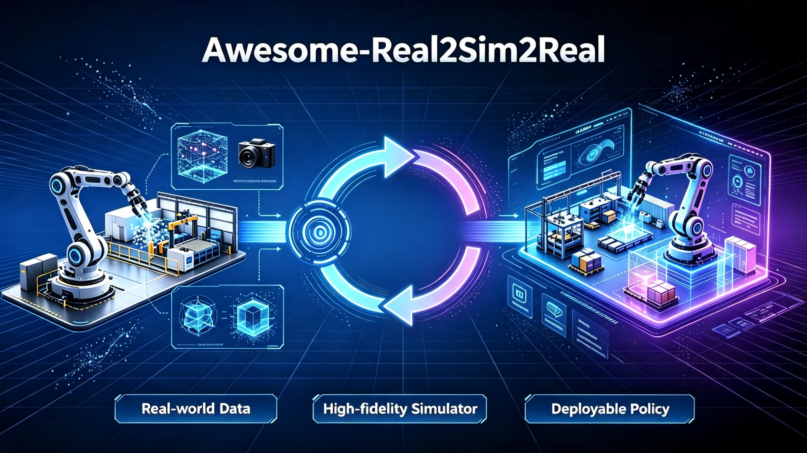

# 🎥 Awesome-Real2Sim2Real

  

> A curated collection of papers on **Sim-to-Real**, **Real-to-Sim**, and **Real2Sim2Real** transfer for robotics, reinforcement learning, and embodied AI.

Sim-to-real transfer addresses the critical challenge of deploying policies trained in simulation to real-world robots, while real-to-sim focuses on reconstructing high-fidelity simulation environments from real-world data. The emerging Real2Sim2Real paradigm closes the loop by using real-world data to build better simulators, which in turn enable more capable real-world policies. This repository tracks the rapid evolution of these interconnected fields from 2024 to 2026.

✅ **Inclusion Criteria**
+ Prioritize high-quality works from top conferences and journals such as CVPR / ICCV / ICLR / NeurIPS / ICML / IROS / ICRA / IEEE RA-L
+ Cover core directions: Reinforcement Learning-based Sim2Real, Zero-Shot Sim2Real, Domain Randomization & Adaptation, Foundation Model-enhanced Sim2Real, Real2Sim from Video, Real2Sim for Manipulation, Real2Sim2Real closed-loop systems, and Benchmarks & Simulators

---

## 📑 Table of Contents
1. [📚 Surveys & Overviews](#-surveys--overviews)
2. [🤖 Sim-to-Real Transfer](#-sim-to-real-transfer)
   - 2.1 [Reinforcement Learning-based Sim2Real](#21-reinforcement-learning-based-sim2real)
   - 2.2 [Zero-Shot Sim2Real](#22-zero-shot-sim2real)
   - 2.3 [Domain Randomization & Adaptation](#23-domain-randomization--adaptation)
   - 2.4 [Foundation Model-enhanced Sim2Real](#24-foundation-model-enhanced-sim2real)
3. [🔄 Real-to-Sim](#-real-to-sim)
   - 3.1 [Real2Sim from Video](#31-real2sim-from-video)
   - 3.2 [Real2Sim for Manipulation & Interaction](#32-real2sim-for-manipulation--interaction)
4. [🔁 Real2Sim2Real Closed Loop](#-real2sim2real-closed-loop)
   - 4.1 [Gaussian Splatting-based Frameworks](#41-gaussian-splatting-based-frameworks)
   - 4.2 [Simulation Frameworks & Pipelines](#42-simulation-frameworks--pipelines)
5. [📊 Benchmarks, Simulators & Datasets](#-benchmarks-simulators--datasets)
6. [🎯 Key Research Challenges](#-key-research-challenges)
7. [🔗 Related Awesome Lists](#-related-awesome-lists)

---

## 📚 Surveys & Overvies

+ **A Survey of Sim-to-Real Methods in RL: Progress, Prospects and Challenges with Foundation Models**
    - Publication: arXiv 2025
    - Highlights: The first taxonomy that formally frames sim-to-real techniques from key elements of the Markov Decision Process (State, Action, Transition, and Reward). Covers comprehensive literature from classic to advanced methods including sim-to-real techniques empowered by foundation models. Summarizes the formal evaluation process of sim-to-real performance with accessible code or benchmarks
    - Paper Link: [arXiv](https://arxiv.org/abs/2502.13187)

+ **A Survey of Robotic Navigation and Manipulation with Physics Simulators in the Era of Embodied AI**
    - Publication: arXiv 2025
    - Highlights: Examines how physics simulators address the sim-to-real gap by analyzing their properties overlooked in previous surveys. Analyzes features for navigation and manipulation tasks along with hardware requirements. Provides a comprehensive overview of recent advancements in robotic navigation and manipulation in Embodied AI
    - Paper Link: [arXiv](https://arxiv.org/abs/2505.01458)

+ **The Reality Gap in Robotics: Challenges, Solutions, and Best Practices**
    - Publication: Annual Review of Control, Robotics, and Autonomous Systems 2026
    - Highlights: A comprehensive overview of the sim-to-real landscape, highlighting the causes, solutions, and evaluation metrics for the reality gap and sim-to-real transfer
    - Paper Link: [arXiv](https://arxiv.org/pdf/2510.20808)

---

## 🤖 Sim-to-Real Transfer

### 2.1 Reinforcement Learning-based Sim2Real

+ **SLIM: Sim-to-Real Legged Instructive Manipulation via Long-Horizon Visuomotor Learning**
    - Publication: arXiv 2025
    - Highlights: Presents a low-cost legged mobile manipulation system that solves long-horizon real-world tasks, trained by reinforcement learning purely in simulation. A single policy autonomously solves long-horizon tasks involving search, move to, grasp, transport, and drop into, achieving nearly 80% real-world success
    - Paper Link: [arXiv](https://arxiv.org/pdf/2501.09905)

+ **Sim-to-Real Reinforcement Learning for Vision-Based Dexterous Manipulation on Humanoids**
    - Publication: arXiv 2025
    - Highlights: Introduces a practical sim-to-real RL recipe that trains a humanoid robot to perform three challenging dexterous manipulation tasks: grasp-and-reach, box lift and bimanual handover
    - Paper Link: [arXiv](https://arxiv.org/abs/2502.20396)

+ **Closing the Sim2Real Performance Gap in RL**
    - Publication: arXiv 2025
    - Highlights: Derives and validates mathematical tools needed to develop bi-level RL algorithms that close the Sim2Real performance gap by directly adapting simulator parameters based on real-world performance
    - Paper Link: [arXiv](https://arxiv.org/pdf/2510.17709)

+ **Sim2Real Reinforcement Learning for Soccer Skills**
    - Publication: arXiv 2025
    - Highlights: Presents a more efficient and effective approach to training control-related tasks for humanoid robots using Reinforcement Learning
    - Paper Link: [arXiv](https://arxiv.org/abs/2512.12437)

+ **Sim-to-Real Transfer for Mobile Robots with Reinforcement Learning: from NVIDIA Isaac Sim to Gazebo and Real ROS 2 Robots**
    - Publication: arXiv 2025
    - Highlights: A comprehensive framework for sim-to-real transfer of mobile robots using reinforcement learning
    - Paper Link: [arXiv](https://arxiv.org/abs/2501.02902)

+ **DiAReL: Reinforcement Learning with Disturbance Awareness for Robust Sim2Real Policy Transfer in Robot Control**
    - Publication: arXiv 2023
    - Highlights: A reinforcement learning framework with disturbance awareness for robust sim-to-real policy transfer in robot control
    - Paper Link: [arXiv](https://arxiv.org/pdf/2306.09010)

### 2.2 Zero-Shot Sim2Real

+ **Actuator Reality Shaping for Zero-Shot Sim-to-Real Robot Learning**
    - Publication: arXiv 2026
    - Highlights: Shapes the closed-loop behavior of physical actuators to match idealized second-order reference dynamics used in simulation. Offers an alternative to making simulators more realistic by shaping reality to match simulation
    - Paper Link: [arXiv](https://arxiv.org/abs/2607.02205)

+ **SimToolReal: An Object-Centric Policy for Zero-Shot Dexterous Tool Manipulation**
    - Publication: arXiv 2026
    - Highlights: Proposes an object-centric policy for zero-shot dexterous tool manipulation. Generalizes across a diverse set of everyday tools, achieving strong zero-shot performance
    - Paper Link: [arXiv](https://arxiv.org/abs/2602.16863)

+ **Isaac Sim-to-Real: Reinforcement Learning based Locomotion for Quadrupeds**
    - Publication: arXiv 2026
    - Highlights: Utilizes NVIDIA's Isaac Sim and Isaac Lab for training, achieving zero-shot sim-to-real policy transfer to the Unitree Go1 quadruped robot
    - Paper Link: [arXiv](https://arxiv.org/pdf/2607.18135)

+ **Efficient Sim-to-Real Transfer of World-Action Models from Synthetic Priors**
    - Publication: arXiv 2026
    - Highlights: Presents the first zero-shot sim-to-real transfer of a world-action model for robotic manipulation. Achieves 35% average success across four real-world tasks using fully automated simulation demonstrations
    - Paper Link: [arXiv](https://arxiv.org/pdf/2606.31101)

+ **SimWeaver: Zero-Shot RGB Sim-to-Real for Deformable Manipulation**
    - Publication: arXiv 2026
    - Highlights: Zero-shot RGB sim-to-real framework for deformable manipulation
    - Paper Link: [arXiv](https://arxiv.org/pdf/2606.15338)

+ **Right-Side-Out: Learning Zero-Shot Sim-to-Real Garment Reversal**
    - Publication: arXiv 2025
    - Highlights: A zero-shot sim-to-real framework that solves garment reversal by exploiting task structures through task decomposition and high-fidelity simulation, enabling highly dynamic, severely occluded tasks without laborious human demonstrations
    - Paper Link: [arXiv](https://arxiv.org/pdf/2509.15953)

+ **FetchBot: Learning Generalizable Object Fetching in Cluttered Scenes via Zero-Shot Sim2Real**
    - Publication: Proceedings of MLR 2025
    - Highlights: Introduces FetchBot, a sim-to-real framework for object fetching in cluttered scenes. Curates a large-scale synthetic dataset featuring 1M diverse scenes and 500k representative demonstrations
    - Paper Link: [arXiv](https://arxiv.org/pdf/2502.17894)

+ **DiffuDepGrasp: Diffusion-based Depth Noise Modeling Empowers Sim2Real Robotic Grasping**
    - Publication: arXiv 2025
    - Highlights: A deploy-efficient sim2real framework enabling zero-shot transfer through simulation-exclusive policy training, achieving a 95.7% average success rate on 12-object grasping with zero-shot transfer and strong generalization to unseen objects
    - Paper Link: [arXiv](https://arxiv.org/pdf/2511.12912)

### 2.3 Domain Randomization & Adaptation

+ **How Should a Simulation-to-Reality Transfer Budget Be Spent?**
    - Publication: arXiv 2026 (IROS 2026 Workshop)
    - Highlights: Given a small budget of real-robot data, systematically studies whether it is better to measure the system or to randomize the simulator
    - Paper Link: [arXiv](https://arxiv.org/abs/2606.22062)

+ **SPARR: Simulation-based Policies with Asymmetric Real-world Residuals for Assembly**
    - Publication: arXiv 2026
    - Highlights: Simulation-based policies with asymmetric real-world residuals for assembly tasks
    - Paper Link: [arXiv](https://arxiv.org/pdf/2602.23253)

+ **Towards Bridging the Gap: Systematic Sim-to-Real Transfer for Diverse Legged Robots**
    - Publication: arXiv 2025
    - Highlights: Proposes PACE (Physics-Aware Calibration Engine), a systematic approach for sim-to-real transfer across diverse legged robots
    - Paper Link: [arXiv](https://arxiv.org/pdf/2509.06342)

+ **Impact of Static Friction on Sim2Real in Robotic Reinforcement Learning**
    - Publication: arXiv 2025
    - Highlights: Investigates the underexplored impact of Static friction on the Sim2Real gap, proposing a Static friction-aware domain randomization method to bridge the simulation-to-reality transfer
    - Paper Link: [arXiv](https://arxiv.org/pdf/2503.01255)

+ **Safe Continual Domain Adaptation after Sim2Real Transfer of Reinforcement Learning Policies in Robotics**
    - Publication: arXiv 2025
    - Highlights: Proposes a method to enable safe deployment-time policy adaptation in real-world robot control, addressing limitations of existing domain randomization approaches
    - Paper Link: [arXiv](https://arxiv.org/pdf/2503.10949)

### 2.4 Foundation Model-enhanced Sim2Real

+ **Scaling Sim-to-Real Reinforcement Learning for Robot VLAs with Generative 3D Worlds**
    - Publication: arXiv 2026
    - Highlights: Shows that VLAs can be RL fine-tuned without sacrificing generality by leveraging 3D world generative models, demonstrating that increasing scene diversity directly improves zero-shot generalization
    - Paper Link: [arXiv](https://arxiv.org/pdf/2603.18532)

+ **Sim2Real Diffusion: Leveraging Foundation Vision Language Models for Adaptive Automated Driving**
    - Publication: arXiv 2025
    - Highlights: Proposes a novel sim2real transfer method that generates an adapted camera frame representation from the target domain aligned with the source domain distribution, leveraging foundation models with few-shot fine-tuning and textual/image prompts
    - Paper Link: [arXiv](https://arxiv.org/pdf/2507.00236)

+ **World Simulation with Video Foundation Models for Physical AI**
    - Publication: arXiv 2025
    - Highlights: Introduces Cosmos-Predict2.5 and Cosmos-Transfer2.5, advanced Physical AI models that unify text, image, and video generation, enabling Sim2Real and Real2Real world translation with higher fidelity
    - Paper Link: [arXiv](https://arxiv.org/pdf/2511.00062)

+ **Ontology-Guided Diffusion for Zero-Shot Visual Sim2Real Transfer**
    - Publication: arXiv 2025
    - Highlights: Ontology-guided diffusion for zero-shot visual sim-to-real transfer
    - Paper Link: [arXiv](https://arxiv.org/pdf/2603.18719)

---

## 🔄 Real-to-Sim

### 3.1 Real2Sim from Video

+ **Ψ-Map: Panoptic Surface Integrated Mapping Enables Real2Sim Transfer**
    - Publication: arXiv 2026
    - Highlights: Proposes a comprehensive framework that integrates geometric reinforcement to facilitate successful Sim2Real transfer through high-fidelity Real2Sim mapping
    - Paper Link: [arXiv](https://arxiv.org/abs/2604.10982)

+ **CRISP: Contact-Guided Real2Sim from Monocular Video with Planar Scene Primitives**
    - Publication: NeurIPS 2025
    - Highlights: Recovers simulatable human motion and scene geometry from monocular video. Reduces motion tracking failure rates from 55.2% to 6.9% on human-centric video benchmarks, while delivering 43% faster RL simulation throughput. Achieves over 97% success rate on benchmarks
    - Paper Link: [arXiv](https://arxiv.org/abs/2512.14696)

+ **Vid2Sim: Realistic and Interactive Simulation from Video for Urban Navigation**
    - Publication: CVPR 2025
    - Highlights: A novel framework that bridges the sim2real gap through a scalable real2sim pipeline for neural 3D scene reconstruction and simulation. Given a monocular video, generates photo-realistic and physically interactable 3D simulation environments
    - Paper Link: [arXiv](https://arxiv.org/pdf/2501.06693)

+ **Re^3Sim: Generating High-Fidelity Simulation Data via 3D-Photorealistic Real-to-Sim for Robotic Manipulation**
    - Publication: arXiv 2025
    - Highlights: A 3D-photorealistic real-to-sim system addressing geometric and visual sim-to-real gaps, employing advanced 3D reconstruction and neural rendering techniques to faithfully recreate real-world scenarios
    - Paper Link: [arXiv](https://arxiv.org/pdf/2502.08645)

+ **One-Shot Real-to-Sim via End-to-End Differentiable Simulation and Rendering**
    - Publication: IEEE Robotics and Automation Letters 2025
    - Highlights: One-shot real-to-sim via end-to-end differentiable simulation and rendering
    - Paper Link: [arXiv](https://arxiv.org/pdf/2412.00259)

+ **Real-to-Sim Robot Policy Evaluation with Gaussian Splatting Simulation of Soft-Body Interactions**
    - Publication: arXiv 2025
    - Highlights: Real-to-sim robot policy evaluation with Gaussian splatting simulation of soft-body interactions
    - Paper Link: [arXiv](https://arxiv.org/pdf/2511.04665)

+ **Can Real-to-Sim Approaches Capture Dynamic Fabric Behavior for Robotic Fabric Manipulation?**
    - Publication: arXiv 2025
    - Highlights: Presents a rigorous evaluation of Real-to-Sim parameter estimation approaches for fabric manipulation, aligning the physical behavior of simulated fabric with real fabric
    - Paper Link: [arXiv](https://arxiv.org/pdf/2503.16310)

### 3.2 Real2Sim for Manipulation & Interaction

+ **Real2Sim via Active Perception with Behavior Trees Automatically Generated by VLMs**
    - Publication: arXiv 2026
    - Highlights: Constructing physically accurate simulation environments traditionally relies on manual system identification or rigid, exhaustive exploration routines
    - Paper Link: [arXiv](https://arxiv.org/pdf/2601.08454)

+ **Real2Sim: A Physics-driven and Editable Gaussian Splatting Framework for Autonomous Driving Scenes**
    - Publication: arXiv 2026
    - Highlights: Explicitly reconstructs dynamic driving scenes as temporally continuous Gaussian primitives, supports instance-level editing, and simulates realistic object-object and object-environment interactions
    - Paper Link: [arXiv](https://arxiv.org/pdf/2605.13591)

+ **Real-to-Sim for Highly Cluttered Environments via Physics-Consistent Inter-Object Reasoning**
    - Publication: arXiv 2026
    - Highlights: Reconstructs dynamically consistent 3D scenes from a single RGB-D observation by explicitly modeling inter-object contact and physical constraints, enabling reliable simulation and contact-rich robotic interaction
    - Paper Link: [arXiv](https://arxiv.org/pdf/2602.12633)

+ **Scalable Real2Sim: Physics-Aware Asset Generation Via Robotic Pick-and-Place Setups**
    - Publication: arXiv 2025
    - Highlights: Simulating object dynamics from real-world perception shows great promise for digital twins and robotic manipulation but demands labor-intensive measurements
    - Paper Link: [arXiv](https://arxiv.org/pdf/2503.00370)

---

## 🔁 Real2Sim2Real Closed Loop

### 4.1 Gaussian Splatting-based Frameworks

+ **ExoGS: A 4D Real-to-Sim-to-Real Framework for Scalable Manipulation Data Collection**
    - Publication: arXiv 2026
    - Highlights: A robot-free 4D Real-to-Sim-to-Real framework that captures both static environments and dynamic interactions in the real world and transfers them seamlessly to a simulated environment
    - Paper Link: [arXiv](https://arxiv.org/pdf/2601.18629)

+ **ReaDy-Go: Real-to-Sim Dynamic 3D Gaussian Splatting Simulation for Environment-Specific Visual Navigation With Moving Obstacles**
    - Publication: arXiv 2026
    - Highlights: Real-to-sim dynamic 3D Gaussian splatting simulation for environment-specific visual navigation with moving obstacles
    - Paper Link: [arXiv](https://arxiv.org/pdf/2602.11575)

+ **DISCOVERSE: Efficient Robot Simulation in Complex High-Fidelity Environments**
    - Publication: IROS 2025
    - Highlights: The first unified, modular, open-source 3DGS-based simulation framework for Real2Sim2Real robot learning. Features a holistic Real2Sim pipeline that synthesizes hyper-realistic geometry and appearance of complex real-world scenarios, paving the way for analyzing and bridging the Sim2Real gap
    - Paper Link: [arXiv](https://arxiv.org/abs/2507.21981)

+ **RL-GSBridge: 3D Gaussian Splatting Based Real2Sim2Real Method for Robotic Manipulation Learning**
    - Publication: arXiv 2024
    - Highlights: A novel real-to-sim-to-real framework incorporating 3D Gaussian Splatting into conventional RL simulation pipelines, enabling zero-shot sim-to-real transfer for vision-based deep reinforcement learning
    - Paper Link: [arXiv](https://arxiv.org/pdf/2409.20291)

+ **RoboSimGS: High-Fidelity Simulated Data Generation for Real-World Zero-Shot Robotic Manipulation Learning with Gaussian Splatting**
    - Publication: arXiv 2025
    - Highlights: A Real2Sim2Real framework that uses 3D Gaussian Splatting and mesh primitives to create scalable, high-fidelity, and physically interactive simulation environments, enabling successful zero-shot sim-to-real transfer
    - Paper Link: [arXiv](https://arxiv.org/abs/2510.10637)

### 4.2 Simulation Frameworks & Pipelines

+ **Agentic Real2Sim: Physics-based World Modeling with Vision-Language Agents**
    - Publication: arXiv 2026
    - Highlights: Automated Real2Sim frameworks recover simulation-ready assets and physical parameters from robotic interaction
    - Paper Link: [arXiv](https://arxiv.org/pdf/2607.19190)

+ **Blind Dexterous Grasping via Real2Sim2Real Tactile Policy Learning**
    - Publication: arXiv 2026
    - Highlights: Introduces a Real2Sim tactile calibration pipeline that constructs a contact-calibrated digital-twin simulator capable of reproducing real tactile signals. The deployed policy achieves a 27% real-world grasp success rate across all 20 objects without real-world grasping demonstrations or visual input
    - Paper Link: [arXiv](https://arxiv.org/pdf/2606.11767)

+ **ConCent: Contact-Centric Real-to-Sim-to-Real Learning from One Demonstration**
    - Publication: arXiv 2026
    - Highlights: Proposes a contact-centric real-to-sim-to-real RL framework that uses task-relevant contact event sequences extracted from real demonstrations as the learning objective
    - Paper Link: [arXiv](https://arxiv.org/pdf/2606.30268)

+ **Efficient and Reliable Teleoperation through Real-to-Sim-to-Real Shared Autonomy**
    - Publication: arXiv 2026
    - Highlights: Proposes a real-to-sim-to-real shared autonomy framework that augments human teleoperation with learned corrective behaviors
    - Paper Link: [arXiv](https://arxiv.org/pdf/2603.17016)

+ **REAP: Reinforcement-Learning End-to-End Autonomous Parking with Gaussian Splatting Simulator for Real2Sim2Real Transfer**
    - Publication: arXiv 2026
    - Highlights: Establishes a Real2Sim2Real simulator to ensure trained reinforcement learning networks can directly transfer to real-world scenarios
    - Paper Link: [arXiv](https://arxiv.org/abs/2605.08713)

+ **Sim1: Physics-Aligned Simulator as Zero-Shot Data Scaler in Deformable Worlds**
    - Publication: arXiv 2026
    - Highlights: A physics-aligned real-to-sim-to-real data engine that grounds simulation in the physical world, validating physics-aligned simulation as scalable supervision for deformable manipulation
    - Paper Link: [arXiv](https://arxiv.org/pdf/2604.08544)

+ **SoMA: A Real-to-Sim Neural Simulator for Robotic Soft-body Manipulation**
    - Publication: arXiv 2026
    - Highlights: Improves resimulation accuracy and generalization on real-world robot manipulation by 20%, enabling stable simulation of complex tasks such as long-horizon cloth folding
    - Paper Link: [arXiv](https://arxiv.org/pdf/2602.02402)

+ **World Translation: Minimizing Sim-to-Real Gap with Backward Dynamics Extraction and Unpaired Domain Translation**
    - Publication: arXiv 2026
    - Highlights: Minimizes sim-to-real gap with backward dynamics extraction and unpaired domain translation
    - Paper Link: [arXiv](https://arxiv.org/pdf/2607.18154)

+ **TwinAligner: Visual-Dynamic Alignment Empowers Physics-aware Real2Sim2Real for Robotic Manipulation**
    - Publication: arXiv 2025
    - Highlights: A novel Real2Sim2Real system that addresses both visual and dynamic gaps in robot learning by providing scalable data collection and establishing a trustworthy iterative cycle, accelerating algorithm development
    - Paper Link: [arXiv](https://arxiv.org/pdf/2512.19390)

+ **EmbodiedDreamer: Advancing Real2Sim2Real Transfer for Policy Training via Embodied World Modeling**
    - Publication: arXiv 2025
    - Highlights: A novel framework that reduces the Real2Sim2Real gap from both the physics and appearance perspectives. Proposes PhysAligner, a differentiable physics module designed to reduce the Real2Sim physical gap
    - Paper Link: [arXiv](https://arxiv.org/abs/2507.05198)

+ **EmbodiedSplat: Personalized Real-to-Sim-to-Real Navigation with Gaussian Splats from a Mobile Device**
    - Publication: CVPR 2025
    - Highlights: Personalizes policy training by efficiently capturing scenes with 3D Gaussian Splatting, analyzing training strategies, pre-training datasets, and mesh reconstruction techniques
    - Paper Link: [arXiv](https://arxiv.org/pdf/2509.17430)

+ **SynthDrive: Scalable Real2Sim2Real Sensor Simulation Pipeline for High-Fidelity Asset Generation and Driving Data Synthesis**
    - Publication: arXiv 2025
    - Highlights: A scalable real2sim2real system that leverages 3D generation to automate asset mining, generation, and rare-case data synthesis
    - Paper Link: [arXiv](https://arxiv.org/abs/2509.06798)

+ **VR-Robo: A Real-to-Sim-to-Real Framework for Visual Robot Navigation and Locomotion**
    - Publication: IEEE Robotics and Automation Letters 2025
    - Highlights: A Real-to-Sim-to-Real framework that generates photorealistic and physically interactive digital twin simulation environments for visual navigation and locomotion learning
    - Paper Link: [arXiv](https://arxiv.org/pdf/2502.01536)

+ **X-Sim: Cross-Embodiment Learning via Real-to-Sim-to-Real**
    - Publication: arXiv 2025
    - Highlights: Cross-embodiment learning via real-to-sim-to-real
    - Paper Link: [arXiv](https://arxiv.org/pdf/2505.07096)

---

## 📊 Benchmarks, Simulators & Datasets

+ **Real-is-Sim: Bridging the Sim-to-Real Gap with a Dynamic Digital Twin**
    - Publication: arXiv 2025
    - Highlights: A novel behavior cloning framework that incorporates a dynamic digital twin (based on Embodied Gaussians) throughout the entire policy development pipeline: data collection, training, and deployment
    - Paper Link: [arXiv](https://arxiv.org/pdf/2504.03597)

+ **Robot Policy Evaluation for Sim-to-Real Transfer: A Benchmarking Perspective**
    - Publication: arXiv 2025
    - Highlights: A benchmarking perspective on robot policy evaluation for sim-to-real transfer
    - Paper Link: [arXiv](https://arxiv.org/pdf/2508.11117)

+ **RALAD: Bridging the Real-to-Sim Domain Gap in Autonomous Driving with Retrieval-Augmented Learning**
    - Publication: arXiv 2025
    - Highlights: A novel framework designed to bridge the real-to-sim gap at low cost
    - Paper Link: [arXiv](https://arxiv.org/pdf/2501.12296)

+ **AnyTask: An Automated Task and Data Generation Framework for Advancing Sim-to-Real Policy Learning**
    - Publication: arXiv 2025
    - Highlights: Introduces three AnyTask agents for generating expert demonstrations, trains behavior cloning policies on generated data, validates them in simulation, and deploys them directly on real robot hardware
    - Paper Link: [arXiv](https://arxiv.org/pdf/2512.17853)

+ **DISCOVERSE: Efficient Robot Simulation in Complex High-Fidelity Environments**
    - Publication: IROS 2025
    - Highlights: First unified, modular, open-source 3DGS-based simulation framework for Real2Sim2Real robot learning. Powered by Gaussian Splatting and MuJoCo. Supports massively parallel simulation, multiple sensor modalities, existing 3D assets, robot models, and ROS plugins
    - Paper Link: [arXiv](https://arxiv.org/abs/2507.21981)

+ **RoboGSim: A Real2Sim2Real Robotic Gaussian Splatting Simulator**
    - Publication: arXiv 2024
    - Highlights: A Real2Sim2Real robotic Gaussian Splatting simulator for synthesizing simulated data with novel views, objects, trajectories, and scenes
    - Paper Link: [arXiv](https://arxiv.org/pdf/2411.11839)

+ **SynthDrive: Scalable Real2Sim2Real Sensor Simulation Pipeline for High-Fidelity Asset Generation and Driving Data Synthesis**
    - Publication: arXiv 2025
    - Highlights: A scalable real2sim2real sensor simulation pipeline for high-fidelity asset generation and driving data synthesis for autonomous driving
    - Paper Link: [arXiv](https://arxiv.org/pdf/2509.06798)

---

## 🎯 Key Research Challenges

### Universal Foundational Challenges
1. **Reality Gap**: Mismatches in physical dynamics, sensory inputs, and environmental variability between simulation and the real world remain the fundamental obstacle.
2. **High-Fidelity Simulation Cost**: Creating accurate simulators requires significant manual effort for system identification, asset creation, and parameter tuning.
3. **Generalization**: Policies trained in simulation often overfit to specific simulator dynamics and fail to generalize to real-world variations.
4. **Data Scarcity**: Real-world robot data is expensive and time-consuming to collect, limiting the scale of supervised learning approaches.

### Domain-Specific Challenges

| Research Direction | Core Open Challenges | Recent Advances (2026) |
| :--- | :--- | :--- |
| **Sim-to-Real Transfer** | Robustness to unmodeled dynamics; transferability of vision-based policies; sample efficiency in real-world fine-tuning. | **Actuator Reality Shaping** offers a paradigm shift by shaping reality to match simulation. **DexScale** automates data scaling for generalizable control. |
| **Real-to-Sim** | Recovering accurate physical parameters from video; handling complex deformable objects; scalability to diverse environments. | **CRISP** achieves high-fidelity Real2Sim from monocular video with contact guidance. **Vid2Sim** generates interactive 3D environments from urban navigation videos. |
| **Real2Sim2Real Closed Loop** | Bridging both visual and dynamics gaps; maintaining consistency across the loop; efficient online adaptation. | **DISCOVERSE** provides a unified 3DGS-based framework. **TwinAligner** addresses visual-dynamic alignment. **EmbodiedDreamer** uses world modeling to reduce the gap. |
| **Foundation Model Integration** | Leveraging VLMs for automatic system identification; using generative models for data augmentation; safety and reliability concerns. | **Sim2Real Diffusion** uses VLMs for adaptive driving. **Scaling Sim-to-Real RL for VLAs** shows promise with generative 3D worlds. |

---

## 🔗 Related Awesome Lists

- [AwesomeSim2Real](https://github.com/LongchaoDa/AwesomeSim2Real) — Sim-to-Real Methods in RL

---

## ❤️ Contact
If you have suggestions for new papers or datasets, spot any inaccuracies, or find this curated resource list helpful, feel free to reach out to Yuanliang Sun via email at sun254667307@gmail.com.
For inquiries about research internship opportunities in egocentric vision, you are welcome to contact me at any time.

---

## 📄 License

CC0 1.0 Universal. Full terms available in the `LICENSE` file.
